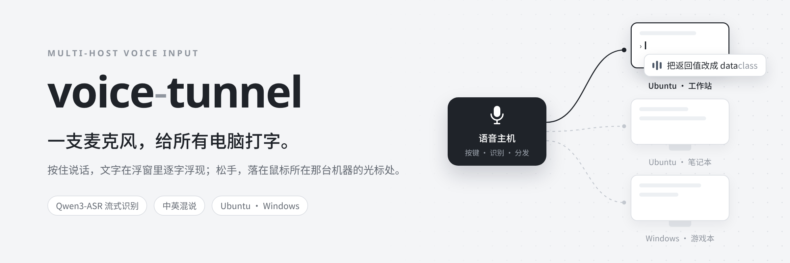
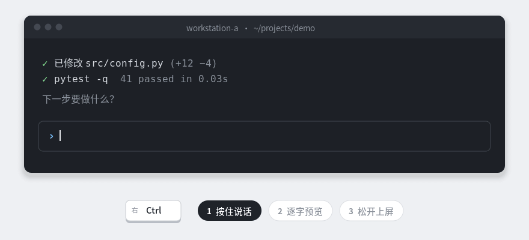
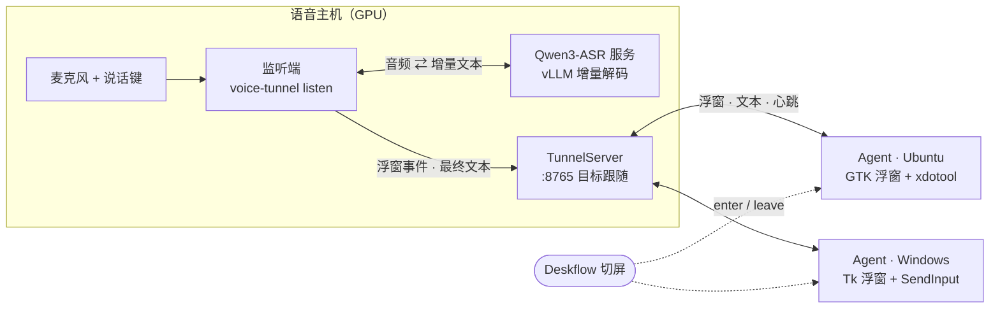

<div align="center">



<p>
  
  
  
  
  
</p>

<p>
  <a href="#快速开始">快速开始</a> ·
  <a href="#工作原理">工作原理</a> ·
  <a href="#实测性能">实测性能</a> ·
  <a href="docs/architecture.md">架构文档</a> ·
  <a href="docs/protocol.md">协议</a>
</p>

</div>

<br>

<p align="center">
  
</p>

<p align="center"><sub>动图由仓库里真实的浮窗绘制代码与状态机离屏渲染（<code>scripts/make_demo.py</code>），场景为虚构终端。</sub></p>

## 为什么做这个

多台电脑共用一套键鼠（Deskflow）时，语音输入法只能装在一台机器上，切到别的屏幕就用不了了。voice-tunnel 把**识别**集中在一台有 GPU 的语音主机上，把**上屏**交给每台电脑上的轻量 Agent：鼠标在哪台机器上，话就打在哪台机器的光标处，并且像输入法一样边说边显示。

## 特性

<table>
<tr>
<td width="33%" valign="top">

**一支麦克风，多台电脑**<br>
<sub>跟随 Deskflow 切屏自动切换目标；按下说话键即锁定，整句不会中途漂到别的屏幕。</sub>

</td>
<td width="33%" valign="top">

**流式逐字浮窗**<br>
<sub>按下即弹出，约 0.5 秒出首字、0.24 秒刷新；未稳定的尾字浅灰显示，松手后整段校正再上屏。</sub>

</td>
<td width="33%" valign="top">

**中英混说**<br>
<sub>Qwen3-ASR-1.7B + 自动领域上下文（在线设备名）+ 数字规范化，端口、IP、版本号直接写成阿拉伯数字。</sub>

</td>
</tr>
<tr>
<td valign="top">

**不抢焦点**<br>
<sub>浮窗是不激活的弹层（Linux override-redirect / Windows <code>WS_EX_NOACTIVATE</code>），打字中途弹出也不会打断。</sub>

</td>
<td valign="top">

**长句不截断**<br>
<sub>服务端每 20 秒在停顿处定稿一段，解码耗时不随句长增长；实测 57.6 秒连续口述完整上屏。</sub>

</td>
<td valign="top">

**单文件 Agent**<br>
<sub>只依赖 Python 标准库；心跳、断线重连、请求去重，Windows 用 Unicode <code>SendInput</code> 整段提交。</sub>

</td>
</tr>
</table>

## 工作原理



1. **按下**：监听端向服务端问清当前目标主机并锁定，目标机立即弹出聆听浮窗。
2. **说话**：音频每 0.12 秒推给 ASR 服务，服务端把新音频合并后只解一次（以上次结果回滚 5 个 token 为前缀），结果经数字规范化后推到目标机浮窗；停顿 0.7 秒时做一次无前缀整段重解码，修正前文。
3. **松开**：整段收尾，文本发给目标机 Agent 注入，浮窗在上屏的同时消失。

目标跟随靠 Deskflow 的 `enterCommand` / `exitCommand` 通知本机 Agent，服务端用心跳兜底丢失的事件。细节见 [docs/architecture.md](docs/architecture.md)，消息格式见 [docs/protocol.md](docs/protocol.md)。

## 实测性能

RTX 2060 12GB，Qwen3-ASR + vLLM 0.14，四台主机（3 台 Ubuntu、1 台 Windows 10）局域网。

| 指标 | 结果 |
| --- | --- |
| 按下 → 浮窗出现 | 即时（不等识别） |
| 首字出现 | 约 0.5 秒 |
| 预览刷新间隔 | 中位数 0.24 秒 |
| 松手 → 文字上屏 | 0.07 – 0.27 秒 |
| 长句 | 57.6 秒连续口述，242 字完整上屏 |
| 中英混说（16 句真实口述） | 设备名、IP、端口、版本号、数字类错误基本消除 |

<sub>延迟数据在 0.6B 模型上测得；当前默认的 1.7B 单句整段识别约 0.3 – 0.5 秒，流式延迟待复测。</sub>

## 快速开始

**1. 安装**（每台机器都需要仓库；目标机只用到 `agent/` 下的单个文件）

```bash
git clone <repo-url> voice-tunnel && cd voice-tunnel
python3 -m venv .venv && . .venv/bin/activate
pip install -e ".[voice]"          # 仅语音主机需要 [voice]
cp config.example.ini config.ini   # 修改 token、server 地址、本机 host 名
```

**2. 语音主机**：启动服务端和监听端（ASR 服务未运行时，监听端会自动拉起，模型常驻）

```bash
voice-tunnel serve  --config config.ini
voice-tunnel listen --config config.ini     # 按住右 Ctrl 说话
```

**3. 每台目标机**：启动 Agent（必须在图形桌面会话里运行）

```bash
python3 agent/voice_tunnel_agent.py --config config.ini --host <本机名>
```

**4. Deskflow**：在每台机器的屏幕设置里填上切屏命令

```text
enterCommand  curl -X POST 'http://127.0.0.1:8766/active?state=enter'
exitCommand   curl -X POST 'http://127.0.0.1:8766/active?state=leave'
```

不接麦克风也能先把链路跑通：

```bash
scripts/smoke_test.sh                                            # 本机起服务端 + dry-run Agent，端到端自检
voice-tunnel send    --target <本机名> --text "hello 语音隧道"    # 直接发一段文本
voice-tunnel preview --target <本机名> --text "这是已经识别的部分" --stable 4   # 只预览浮窗
voice-tunnel final   --target <本机名>                            # 收起浮窗
voice-tunnel status                                              # 当前目标与在线 Agent
```

## 配置

常用项（完整注释见 [`config.example.ini`](config.example.ini)）：

```ini
[voice]
backend = qwen3                      # whisper | qwen3
qwen_backend = vllm                  # vllm 流式 | transformers 整段
model = <data_dir>/models/Qwen3-ASR-1.7B
qwen_gpu_memory_utilization = 0.75   # 1.7B 需要 0.75；0.6B 用 0.35~0.55 即可
ptt_key = KEY_RIGHTCTRL              # 不知道键名：voice-tunnel keytest
context = 程序员日常口述，中英文混合。…  # 领域上下文，在线设备名会自动追加

[agent]
server = 192.168.x.x                 # 语音主机地址
token = change-me
host = workstation-a                 # 本机名，Deskflow 切屏与 --target 都用它
inject_mode = auto                   # auto | xdotool | clipboard
```

## 桌面界面

<p align="center"></p>

`python3 gui/voice_tunnel_gui.py`：顶部显示监听状态和当前目标，右侧列出各 Agent 在线情况；可改说话键（点击后直接按键识别）、麦克风、识别后端、模型、目标主机与数据目录。`Ctrl+R` 开始、`Ctrl+T` 停止，关闭窗口最小化到托盘。

## 进阶

<details>
<summary><b>安装 Qwen3-ASR（vLLM 流式）环境</b></summary>

<br>

模型、虚拟环境、日志统一放在 `[voice] data_dir`（默认 `~/.cache/voice-tunnel`）：

```text
<data_dir>/models/           Qwen3-ASR-1.7B、Qwen3-ASR-0.6B、faster-whisper-*
<data_dir>/venvs/qwen-vllm/  vLLM 流式后端环境（约 9.6GB）
<data_dir>/venvs/qwen/       transformers 后端环境
<data_dir>/logs/             qwen-service.log、listen.log
```

```bash
DATA_DIR=~/.cache/voice-tunnel
uv venv --python 3.10 "$DATA_DIR/venvs/qwen-vllm"
uv pip install --python "$DATA_DIR/venvs/qwen-vllm/bin/python" vllm==0.14.0
uv pip install --python "$DATA_DIR/venvs/qwen-vllm/bin/python" qwen-asr==0.0.6 --no-deps \
  accelerate==1.12.0 nagisa soynlp qwen-omni-utils librosa soundfile sox pytz flask ninja six dyNET38 audioread
```

模型可从 Hugging Face 或 ModelScope 下载 `Qwen/Qwen3-ASR-1.7B`。手动启动服务（通常不需要，监听端会自动拉起）：

```bash
$DATA_DIR/venvs/qwen-vllm/bin/python scripts/qwen_asr_service.py \
  --model $DATA_DIR/models/Qwen3-ASR-1.7B --port 8771 --backend vllm --gpu-memory-utilization 0.75
```

RTX 2060（sm75）可跑：fp16，FA2 不可用时 encoder 自动退到 SDPA；服务启动时先做一次预热解码，冷启动约 60 秒。

</details>

<details>
<summary><b>说话键（PTT）权限</b></summary>

<br>

监听端直接读键盘的 evdev 设备，需要给当前用户读权限。以 udev 规则为例（把 VID/PID 换成自己的键盘，`lsusb` 可查）：

```text
# /etc/udev/rules.d/99-voice-tunnel.rules
SUBSYSTEM=="input", KERNEL=="event*", ATTRS{idVendor}=="xxxx", ATTRS{idProduct}=="xxxx", TAG+="uaccess"
```

右 Ctrl 与快捷键冲突时，用 `voice-tunnel keytest` 换成 Pause、F13 等不常用的键。

</details>

<details>
<summary><b>Windows Agent 部署要点</b></summary>

<br>

- Agent 必须运行在用户桌面会话里。从 SSH 启动会落在 Session 0（没有桌面，浮窗不可见，`SendInput` 无效），Agent 会直接拒绝启动。推荐用"登录时运行"的计划任务拉起。
- 计划任务调用的 PowerShell 脚本请存为 **UTF-8 BOM**，否则 PowerShell 5 会按本地代码页解析中文注释，吞掉换行导致任务失败。
- 进程开启 Per-Monitor DPI 感知；浮窗优先放在输入光标下方（`GetGUIThreadInfo` → MSAA caret），拿不到时回退到鼠标位置。
- 不支持 UAC 高权限窗口和独占全屏游戏。

</details>

<details>
<summary><b>识别后端对比</b></summary>

<br>

同一段 3.8 秒中文 TTS 音频：

| 后端 | 结果 | 耗时 |
| --- | --- | --- |
| faster-whisper small | 你好,这是一段幽灵美音在生产的测试音。 | 0.16 秒 |
| Qwen3-ASR-0.6B（transformers） | 你好，这是一段由灵美音色生成的测试语音。 | 约 1.0 秒 |
| Qwen3-ASR-0.6B（vLLM） | 同上 | 约 0.12 秒（稳态） |

中英混说（真实口述）：0.6B 会把“x99”写成“叉九九”、“129”写成“一百二十九”；换 1.7B 并加上领域上下文和数字规范化后，这类错误基本消除。仍会出错的是上下文里没有的生僻词。

</details>

## 已知限制

- Ubuntu 上浮窗跟随鼠标而不是输入光标：多数程序不对外报告光标位置（fcitx 只在聚焦或按键时上报，微信、浏览器、VS Code 默认不开放 AT-SPI）。
- Linux 注入依赖 `xdotool` / `xclip`；剪贴板模式只备份还原文本，图片等多格式内容不保证还原。
- 鼠标停在没有 Agent 的屏幕上时目标为“无”，语音不会被送到别的机器。
- 生僻专有名词（不在上下文里的产品名、缩写）仍可能识别错。

## 路线图

- [ ] 跨平台：语音主机与服务端也能部署在 Windows 上（[方案](docs/cross-platform.md)）
- [ ] 松手后用小 LLM 做整句改写，修正上下文之外的专有名词
- [ ] Linux 主机 systemd 自启动
- [ ] 1.7B 模型下的流式延迟复测

## 项目结构

```text
src/voice_tunnel/        服务端、协议、监听端、CLI、数字规范化（itn.py）
agent/                   单文件 Agent（stdlib only，Linux / Windows 通用）
scripts/                 Qwen3-ASR 服务、冒烟测试、演示动图渲染
gui/                     PyQt5 桌面界面
tests/                   单元测试
docs/                    架构、协议、跨平台方案、实施记录
```

运行测试：`PYTHONPATH=src python3 -m unittest discover -s tests`

## 许可证

[MIT](LICENSE)
