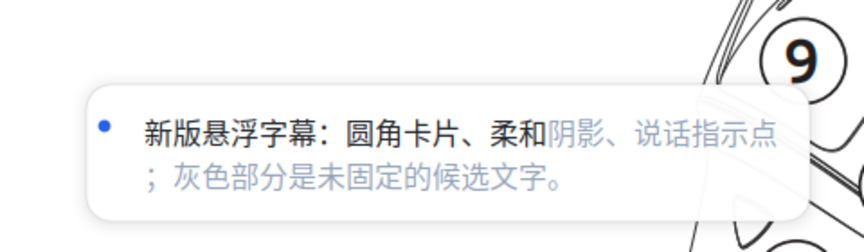
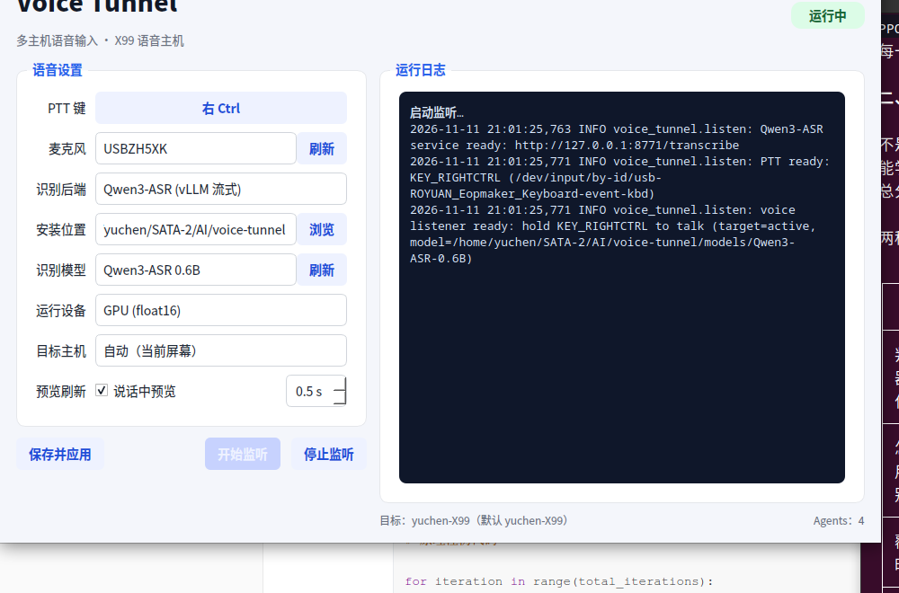

# voice-tunnel

集中式语音识别 + 分布式文本注入，用于多主机 vibe coding。

- **语音主机**：X99（Ubuntu X11，RTX 2060 12GB）负责麦克风、PTT、ASR、术语修正和文本分发。
- **目标主机**：每台 Ubuntu / Windows 跑一个轻量 Agent，把文本插入当前焦点窗口。
- **目标跟随**：Deskflow 的 `enterCommand` / `exitCommand` 通知本机 Agent，Agent 用心跳维护 `active_target`。
- **不抢剪贴板**：默认走本机输入接口；Windows 用 Unicode `SendInput`；Linux 用 XTest/xdotool，中文失败时才按需启用剪贴板回退。

当前阶段：**文本隧道 MVP + 无边框紧凑 HUD**（ASR/PTT 尚未接入）。

已在 X99 + gedit、X99→x670 / .98 上验证中英文/符号注入、焦点保持和剪贴板还原；Windows Agent 已部署连接，SendInput 待真实应用复验。跨主机文本通道已可用；Deskflow 的 enter/exit 事件命令已在 X99/x670/.98 配置，移动鼠标切屏应能自动更新目标。Windows 的 Deskflow 事件尚未配置。

## 目录

```text
src/voice_tunnel/          服务端、协议、CLI
agent/voice_tunnel_agent.py  单文件 Agent（stdlib-only）
config.example.ini         配置示例
docs/                      架构、协议、实施状态
```

## 快速开始

```bash
cd /home/yuchen/Sata-sun/Scripts/voice-tunnel
python3 -m venv .venv
. .venv/bin/activate
pip install -e .
cp config.example.ini config.ini   # 修改 token / server 地址

# 终端 1：服务端
voice-tunnel serve --config config.ini

# 终端 2：本机 Agent（dry-run，不真正注入）
python3 agent/voice_tunnel_agent.py --config config.ini --host yuchen-X99 --dry-run

# 终端 3：发一段文本
voice-tunnel send --config config.ini --target yuchen-X99 --text "hello 语音隧道"
```

HUD 预览联调（不需要 ASR）：

```bash
voice-tunnel preview --target yuchen-X99 --text "这是已经识别的部分" --stable-len 4
voice-tunnel final   --target yuchen-X99 --text "这是已经识别的部分，后面还在识别"
```

Agent 的健康检查：

```bash
curl 'http://127.0.0.1:8766/health'
curl -X POST 'http://127.0.0.1:8766/active?state=enter'
curl -X POST 'http://127.0.0.1:8766/active?state=leave'
```

## 语音输入

```bash
# 1) PTT 设备权限（X99 键盘 3151:4015；已配置可跳过）
# /etc/udev/rules.d/99-voice-tunnel.rules:
# SUBSYSTEM=="input", KERNEL=="event*", ATTRS{idVendor}=="3151", ATTRS{idProduct}=="4015", TAG+="uaccess", RUN+="/usr/bin/setfacl -m u:yuchen:rw $devnode"

# 2) 安装语音依赖（使用本地镜像）
.venv/bin/pip install -e ".[voice]" -i https://mirrors.aliyun.com/pypi/simple --trusted-host mirrors.aliyun.com

# 3) 启动监听（按住右 Ctrl 说话，松开自动识别并插入当前 active target）
.venv/bin/voice-tunnel --config config.ini listen

# 4) 不知道键名时
.venv/bin/voice-tunnel --config config.ini keytest
```

当前默认：`ptt_key=KEY_RIGHTCTRL`，`model=faster-whisper small`（最终识别），`partial_model=faster-whisper small`（说话中预览），GPU float16；识别结果默认转简体（`zhconv`）。

### 安装位置

模型、虚拟环境、日志统一放在 `[voice] data_dir`（默认 `~/.cache/voice-tunnel`；X99 当前为 `/home/yuchen/SATA-2/AI/voice-tunnel`）：

```text
<data_dir>/models/       # faster-whisper-*、Qwen3-ASR-0.6B
<data_dir>/venvs/qwen/       # transformers 后端环境
<data_dir>/venvs/qwen-vllm/  # vLLM 流式后端环境
<data_dir>/logs/         # qwen-service.log
```

界面里的“安装位置”可直接改；服务启动时按该目录找环境和权重，找不到才回退到仓库内 `.venv-qwen`。

### Qwen3-ASR 后端（准确率更高）

```bash
DATA_DIR=/home/yuchen/SATA-2/AI/voice-tunnel
# transformers 后端
$DATA_DIR/venvs/qwen/bin/python scripts/qwen_asr_service.py \
  --model $DATA_DIR/models/Qwen3-ASR-0.6B --port 8770
# vLLM 流式后端（端口 8771，显存占用约 35%）
$DATA_DIR/venvs/qwen-vllm/bin/python scripts/qwen_asr_service.py \
  --model $DATA_DIR/models/Qwen3-ASR-0.6B --port 8771 --backend vllm --gpu-memory-utilization 0.35
```

在界面“识别后端”选 `Qwen3-ASR` 或 `Qwen3-ASR (vLLM 流式)` 即可；监听进程发现服务未启动会自动拉起（模型常驻，冷启动约 9 秒，之后每次转写不再加载模型）。X99 RTX 2060 实测：3.8 秒中文音频约 1.0 秒出结果，`lang=zh` 映射到 `Chinese`，长音频由模型内部按窗口切块。

重装环境（换 `data_dir` 时）：

```bash
DATA_DIR=/home/yuchen/SATA-2/AI/voice-tunnel
# vLLM 流式环境（约 9.6GB）
uv venv --python 3.10 "$DATA_DIR/venvs/qwen-vllm"
uv pip install --python "$DATA_DIR/venvs/qwen-vllm/bin/python" vllm==0.14.0
uv pip install --python "$DATA_DIR/venvs/qwen-vllm/bin/python" qwen-asr==0.0.6 --no-deps \
  accelerate==1.12.0 nagisa soynlp qwen-omni-utils librosa soundfile sox pytz flask ninja six dyNET38 audioread
```

对比 whisper-small（同一段 TTS 音频）：

| 后端 | 结果 | 耗时(3.8s 音频) |
| --- | --- | --- |
| faster-whisper small | 你好,这是一段幽灵美音在生产的测试音。 | 0.16s |
| Qwen3-ASR-0.6B (transformers) | 你好，这是一段由灵美音色生成的测试语音。 | ~1.0s |
| Qwen3-ASR-0.6B (vLLM) | 同上 | ~0.12s（稳态） |

vLLM 流式实测（同一段音频，1s chunk）：0.5s 出“你好。”→ 1.5s 出“你好，这是一段有林。”→ 2.5s 修正为“你好，这是一段由零点音色生成的测试。”→ 松手收尾为“你好，这是一段由灵美音色生成的测试语音。”。HUD 每秒刷新，松手后再做一次整段微调。

## 桌面界面



```bash
python3 gui/voice_tunnel_gui.py
```

- 可在界面里改 PTT 键（点击后按实际按键自动识别）、麦克风（下拉）、模型（下拉）、GPU/CPU、目标主机、安装位置、partial 预览间隔
- “保存并应用”会重启监听；PTT 设备是键盘的 Linux event 节点，默认已指向 ROYUAN 键盘，无需手动改
- `Ctrl+R` 开始监听，`Ctrl+T` 停止
- 关闭窗口会最小化到右上角托盘；点击托盘图标在“显示/隐藏主窗口”之间切换，菜单也会同步
- 已安装应用菜单项：`~/.local/share/applications/voice-tunnel.desktop`

## 当前限制

- Linux 文本注入依赖 `xdotool`（ASCII/部分 Unicode）或显式启用的剪贴板回退。
- Windows 注入在用户会话运行；UAC 高权限窗口暂不支持。
- HUD 是无边框紧凑候选条（1–3 行、半透明、不抢焦点），优先光标、鼠标兜底；AT-SPI/Windows caret 精确定位在后续版本增强。
- 语音采集、ASR、PTT 尚未实现。

## 文档

- `docs/architecture.md`：整体架构和目标跟随设计
- `docs/protocol.md`：TCP/JSON 消息协议
- `docs/implementation-status.md`：已完成 / 下一步
