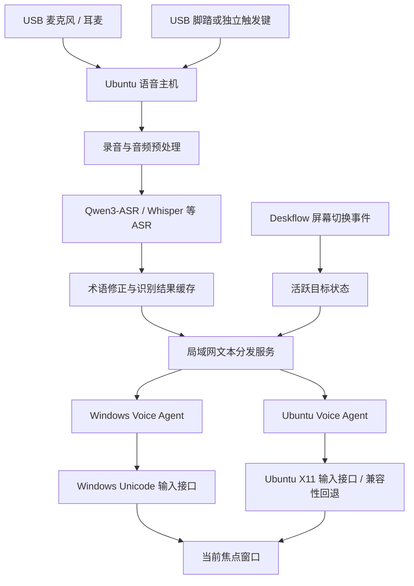

# Ubuntu 多主机语音输入与 Vibe Coding 工作流方案

> **整理日期：** 2026-11-11  
> **语音主机：** Ubuntu X11  
> **KVM 软件：** Deskflow  
> **规划拓扑：** Ubuntu 作为 Deskflow Server，Ubuntu 与 Windows 作为 Client  
> **目标：** 在一台主机集中采集语音和运行 ASR；鼠标切换到哪台电脑，就把识别文本输入到哪台电脑的当前焦点窗口；不破坏原有图片、文本剪贴板工作流，并为未来 Windows 担任 Deskflow Server 留出空间。

## 总体路线

### 核心结论

建议采用 **“集中式 ASR + 分布式输入代理 + Deskflow 焦点状态同步”** 的架构。

- **Ubuntu 语音主机：** 固定负责麦克风采集、语音识别、术语修正、结果缓存和文本分发。
- **Deskflow：** 负责键盘、鼠标和屏幕切换，并提供屏幕进入/离开事件，作为语音系统判断当前输入目标的信号来源。
- **每台目标主机：** 运行一个轻量级 Voice Agent，接收 UTF-8 文本并通过本机输入接口插入当前焦点窗口。
- **活跃目标识别：** 根据 Deskflow 屏幕切换事件维护当前目标主机；在事件链路尚未验证前，先使用手动目标选择。
- **剪贴板：** 语音识别结果先放在独立缓存中。正常情况下不覆盖系统剪贴板；Windows 优先采用 Unicode 键盘注入，Ubuntu X11 对中文输入准备兼容性回退。

这种架构可以覆盖当前规划的 Ubuntu Server → Ubuntu/Windows Client，也能支持未来把 Deskflow Server 角色切换到 Windows。**语音主机和 Deskflow Server 不必是同一台机器。**

### 总体数据流



### 设计原则

| 原则 | 设计选择 | 原因 |
|---|---|---|
| 语音识别集中化 | ASR 固定运行在 Ubuntu | 只维护一套模型、麦克风和术语表 |
| 输入能力本地化 | 每台机器运行 Voice Agent | Windows、X11 的文本注入方式不同 |
| KVM 与语音解耦 | Deskflow 负责键鼠和屏幕切换；语音文本走独立网络通道 | 避免把文本分发绑定到 KVM 的剪贴板行为 |
| 不破坏剪贴板 | 语音结果先进入独立缓存 | 保留用户复制的图片、代码和富文本 |
| 目标主机可切换 | 用 Deskflow 屏幕进入/离开事件更新目标 | 不把“Server”误当作“当前输入目标” |
| 不自动执行命令 | 只插入文本，不自动按 Enter | 避免语音识别错误触发终端命令 |

## 系统架构与角色

### 语音主机：Ubuntu

Ubuntu 固定作为 ASR 主机。即使未来 Deskflow Server 角色迁移到 Windows，也不需要迁移识别服务。

主要职责：

- 从 USB 麦克风或耳麦采集音频。
- 通过脚踏开关或独立按键实现 Push-to-Talk。
- 调用 ASR 模型完成中文、英文和技术术语识别。
- 根据术语表修正常见项目名、模型名和缩写。
- 保存最近若干条识别结果，支持重发或重新插入。
- 根据活跃目标状态，将文本发送给对应 Voice Agent。

如果这台机器同时承担 Isaac Gym、Isaac Lab 等机器人训练任务，建议先测量 CPU 推理延迟，再决定是否使用 GPU。优先测试 Qwen3-ASR-0.6B；如果 CPU 延迟不理想，再指定空闲 GPU 或单独的推理设备，避免和训练任务争抢显存。

### 目标主机：Voice Agent

每台 Ubuntu / Windows 主机运行一个常驻的轻量级客户端。

Voice Agent 的职责：

- 与 Ubuntu 语音主机建立局域网连接。
- 接收经过认证的 `insert_text` 消息。
- 检查本机是否仍是当前活跃目标。
- 将文字插入当前焦点窗口。
- 返回成功、失败或焦点不可用等状态。
- 不执行 shell 命令，不接收任意远程脚本。

建议使用 WebSocket 或 TCP 传输 UTF-8 文本。消息只携带文本、目标机器 ID、请求 ID 和时间戳，不传输麦克风音频，也不需要共享文件系统。

示意消息：

```json
{
  "type": "insert_text",
  "request_id": "unique-id",
  "target": "windows-client",
  "text": "检查 PPO actor 和 critic 的输入维度是否一致"
}
```

局域网服务应使用设备白名单或共享密钥认证，并限制监听地址和防火墙端口。不要把文本接收端暴露到公网。

### Deskflow Server、Client 与当前目标不是同一个概念

需要区分两个概念：

- **Server / Client：** Deskflow 的网络连接角色。Server 负责协调键鼠共享，Client 连接到 Server。
- **当前输入目标：** 鼠标和键盘当前实际控制的屏幕，也就是用户希望插入语音文本的机器。

通常物理键鼠所在机器同时运行 Server 和主控端，但这不是语音系统必须依赖的前提。语音系统应维护独立的 `active_target` 状态，而不是根据 Server 身份推断目标机器。

当前规划拓扑：

```text
Ubuntu（语音主机 + Deskflow Server）
    ├── Ubuntu Client
    └── Windows Client
```

未来可能的拓扑：

```text
Ubuntu（语音主机 + Deskflow Client）
Windows（Deskflow Server）
    └── 其他 Client
```

语音服务仍然运行在 Ubuntu。Windows 担任 Deskflow Server 时，只需要把活跃目标事件通知 Ubuntu 的语音服务，不需要迁移 ASR。

## 软件方案选型

### ASR：优先测试 Qwen3-ASR

优先考虑 [Qwen3-ASR](https://github.com/QwenLM/Qwen3-ASR)。

官方提供 0.6B 和 1.7B 两种模型，支持中文、英文、粤语等多语言识别，并提供离线和流式推理能力。

| 模型 | 建议用途 | 取舍 |
|---|---|---|
| Qwen3-ASR-0.6B | 第一阶段速度测试 | 模型较小，优先验证响应延迟 |
| Qwen3-ASR-1.7B | 准确率对照 | 模型更大，适合比较术语和中英混说效果 |
| Whisper large-v3 / turbo | 备选与基准 | 工具链成熟，可作为对照 |
| SenseVoice | 轻量化备选 | 可测试中文低延迟识别效果 |

第一版建议采用 **按住说话、松开后离线识别**，先把录音、识别、分发、输入链路跑通。Qwen3-ASR 的官方流式推理目前有特定后端要求，不必一开始就引入 vLLM 流式服务。

测试语料应包含实际开发表达，例如：

- “把 PPO 的 rollout storage 改成支持 privileged observation。”
- “检查 actor 和 critic 的输入维度是否一致。”
- “这个函数使用 torch compile 后有没有 graph break？”
- “把 Isaac Lab 的 config 和 environment 注册逻辑拆开。”

术语表应覆盖 `PPO`、`AMP`、`MuJoCo`、`Isaac Lab`、`rollout`、`privileged observation`、`actor`、`critic`、`CUDA`、`ONNX` 等。建议先使用确定性的术语替换，不要默认让 LLM 改写整段文本，以免修改代码符号、路径、参数名和命令。

### 音频采集与触发

建议使用：

- Python `sounddevice` 或 PortAudio 采集音频。
- Linux `python-evdev` 监听指定 USB 脚踏或 HID 按键。
- 第一版采用 Push-to-Talk：按下开始录音，松开结束录音并触发识别。

脚踏设备连接在 Ubuntu 语音主机上。这样即使 Ubuntu 将来变成 Deskflow Client，脚踏仍由本机 evdev 监听，不依赖 Deskflow 是否把某个快捷键转发回来。

如果使用脚踏模拟 F13/F19 等按键，应通过设备路径或 USB Vendor/Product ID 识别指定设备，并测试是否需要独占抓取事件，避免该按键被 Deskflow 转发到其他主机。

### KVM：使用 Deskflow

Deskflow 作为本方案选定的 KVM 软件，负责跨主机键盘、鼠标共享和屏幕切换。

项目地址：[Deskflow GitHub](https://github.com/deskflow/deskflow)。

Deskflow 的配置文档提供 `enterCommand` 和 `exitCommand` 事件钩子，可在屏幕进入或离开时执行命令。这为更新语音系统的活跃目标状态提供了入口。

建议按以下方式接入：

- **第一阶段：** Deskflow 先只负责键鼠共享，语音输入目标使用手动选择。
- **第二阶段：** 验证 `enterCommand` / `exitCommand` 在当前安装版本和 Server / Client 拓扑中的触发行为。
- **第三阶段：** 屏幕切换时，由事件脚本向 Ubuntu 语音服务发送目标主机 ID，更新 `active_target`。
- **未来迁移：** 如果 Windows 成为 Deskflow Server，由 Windows 侧事件脚本通过局域网通知 Ubuntu，ASR 服务仍留在 Ubuntu。

需要实测的重点：

- 进入远端 Client 屏幕时，是否能稳定触发对应事件。
- 从远端屏幕返回 Server 本机时，是否能正确恢复本机目标。
- 多个 Client 之间切换时，能否区分目标主机。
- Server 本机是否也有可用的目标状态通知路径。
- 事件脚本实际在哪台机器执行，以及如何可靠获得目标主机 ID。

不要直接把“Server 名称”当作当前目标。应维护一个独立的 `active_target` 状态，并设置状态超时和手动选择回退。

## 文本注入与剪贴板策略

### 不要把系统剪贴板当作语音消息总线

语音识别完成后，先把结果放进 Voice Server 的内存缓存或本地队列，再通过局域网发送给目标 Agent。

这样用户原先复制的内容不需要改变：

- 复制的图片仍可 Ctrl+V 粘贴。
- 复制的代码、路径和普通文本仍可 Ctrl+V 粘贴。
- 语音识别不会自动覆盖系统剪贴板。
- 语音结果可以保留最近若干条，供重新插入。

### Windows：优先使用 Unicode 输入事件

Windows Agent 可以研究使用 Win32 `SendInput` 的 Unicode 输入方式，把文本作为输入事件发送给当前焦点窗口，不必先替换剪贴板。

需要针对 VS Code 编辑器、VS Code 集成终端、Windows Terminal、浏览器等应用测试。高权限窗口、UAC 安全桌面、远程桌面和部分特殊控件可能有额外限制。

### Ubuntu X11：中文注入需要单独验证

X11 下的 `xdotool` 适合模拟普通按键和部分 ASCII 文本，但不应把它视为所有中文输入法、终端和 GTK/Qt 应用都可靠的任意 Unicode 文本注入接口。

建议按优先级实现：

- 对 ASCII / 英文内容先测试 XTest / `xdotool` 直接输入。
- 对中文文本评估输入法接口或应用专用接口。
- 如果需要兼容任意应用，可将临时剪贴板粘贴作为回退路径，但必须明确它会短暂使用系统剪贴板。

### 如何保护原有图片和文本剪贴板

不能只备份剪贴板中的纯文本。图片、HTML、富文本等通常通过多个 MIME / Target 格式提供，简单执行 `xclip -o` 只能取到某一种目标，不能保证完整保存并恢复所有内容。

因此：

- 不要让 ASR 每次识别都覆盖系统剪贴板。
- 不要把“保存纯文本 → 替换 → 粘贴 → 恢复”当作无损方案。
- 如需临时剪贴板回退，应单独实现多格式备份和恢复，并测试图片、HTML、文件列表等内容。
- 可以结合剪贴板历史工具提升误覆盖后的恢复能力，但剪贴板历史不等于完整、原子化的恢复保证。

第一版可先让 Windows 实现无剪贴板注入；Ubuntu X11 先验证实际中文输入路径，再决定采用 IME 接口还是临时剪贴板回退。

## 硬件建议

### 麦克风

先使用现有耳麦或 USB 麦克风测试，不需要一开始购买专业声卡。

优先级：

- **USB 有线耳麦：** 麦克风靠近嘴部，成本低，键盘噪声较容易控制。
- **USB 动圈桌面麦克风：** 适合不想佩戴耳机的场景，但需要控制麦克风与嘴部距离。
- **暂不优先考虑远场阵列麦克风：** 桌面机械键盘、风扇和房间混响会增加识别难度。

### 触发设备

推荐可编程 USB 单脚踏开关，或独立 USB HID 按键。

脚踏的价值是让双手持续操作键盘和鼠标，同时避免依赖当前焦点主机上的全局快捷键。设备应支持稳定的 HID / evdev 识别，购买前确认能否配置成独立按键事件。

## 实施路线

### 环境确认与基线测试

当前 Ubuntu 已确认使用 X11。可用以下命令记录版本和会话信息：

```bash
echo "$XDG_SESSION_TYPE"
lsb_release -ds
```

在 Windows 和 Ubuntu 两端记录：

- Deskflow 版本和 Server / Client 角色。
- 每台主机的固定主机名、局域网 IP。
- 目标应用和输入法。
- 是否安装剪贴板管理器。
- 是否需要跨不同用户权限级别的窗口输入。

### 先做文本分发 MVP，不接 ASR

第一阶段只实现：

```text
手动选择目标主机
    ↓
Ubuntu 发送一段测试文本
    ↓
目标 Voice Agent 接收文本
    ↓
插入当前焦点窗口
    ↓
返回执行结果
```

测试内容至少包括中文、英文、数字、下划线、路径、括号和常见代码符号。

测试应用至少包括：

- VS Code / Cursor 编辑器。
- VS Code 集成终端。
- Windows Terminal。
- 浏览器文本框。

先验证两条链路：

- Ubuntu → Windows Client。
- Ubuntu → Ubuntu Client。

这一阶段不需要安装 ASR 模型，也不需要改动 Deskflow 的屏幕切换事件配置。

### 接入 Deskflow 活跃目标检测

文本注入通过后，再解决自动选择目标的问题。

先用手动目标选择验证 Voice Agent；随后评估 Deskflow 的 `enterCommand` / `exitCommand`。当屏幕切换时，由 Deskflow 事件脚本更新 Ubuntu ASR 服务中的 `active_target`。

建议设置状态超时和安全回退：如果事件丢失、Agent 离线或目标状态不确定，不要把文本发送到猜测的机器，而是提示用户手动选择目标。

### 接入 ASR 与脚踏

最后接入：

- 麦克风采集。
- Push-to-Talk。
- Qwen3-ASR。
- 技术术语修正。
- 识别结果预览和缓存。
- 目标 Agent 文本插入。

默认只插入文本，不自动按 Enter，不自动执行终端命令。可以提供“识别后预览”和“直接输入”两种模式。

## 验收标准与风险

### 功能验收

| 测试项 | 通过标准 |
|---|---|
| Ubuntu → Windows | 中文、英文和代码符号能进入当前焦点窗口 |
| Ubuntu → Ubuntu | 编辑器和终端中的输入符合预期 |
| 剪贴板保护 | 语音识别前复制的图片、文本仍能正常 Ctrl+V |
| 目标切换 | 鼠标切换到另一台主机后，语音文本进入新目标 |
| 目标失效 | Agent 离线或目标状态过期时，不误发到其他主机 |
| 触发设备 | 脚踏在鼠标切换到 Client 后仍能触发 Ubuntu 录音 |
| Deskflow Server 迁移 | Windows 成为 Server 后，ASR 仍留在 Ubuntu |
| 安全性 | Agent 只接受认证的文本插入请求，不执行远程命令 |

### 主要风险

- **Deskflow 目标状态同步：** 屏幕进入/离开事件可能丢失或不覆盖某些边界情况，必须有手动选择和超时保护。
- **X11 中文注入：** 普通按键模拟与输入法文本提交不是一回事，需要单独测试。
- **ASR 术语错误：** 需要用实际开发语料建立测试集和术语表。
- **终端误执行：** 识别结果只插入，不自动提交，避免误识别造成命令执行。
- **权限差异：** Windows 高权限窗口和 Linux 不同用户会话可能阻止输入注入。
- **剪贴板格式：** 临时剪贴板回退可能无法完整恢复多格式内容，因此不能作为默认路径。

## 最终推荐

建议按以下组合开始：

| 层级 | 推荐方案 |
|---|---|
| 语音主机 | Ubuntu X11 |
| KVM | Deskflow；规划 Ubuntu Server、Ubuntu / Windows Client |
| ASR | Qwen3-ASR-0.6B 起步，1.7B 做准确率对照 |
| 音频采集 | USB 耳麦 / 麦克风 + Python `sounddevice` |
| 触发 | USB 脚踏 + `evdev` |
| 文本传输 | 局域网 WebSocket / TCP |
| Windows 输入 | Voice Agent + Win32 Unicode 输入 |
| Ubuntu 输入 | Voice Agent + X11 输入接口，中文必要时回退 |
| 目标选择 | 初期手动选择，之后接 Deskflow `enterCommand` / `exitCommand` 事件 |
| 剪贴板 | 独立语音缓存，不作为默认输入通道 |

**最重要的实施顺序是：先做跨主机文本注入 MVP，再接 Deskflow 活跃目标识别，最后接入 ASR。**

这样可以先验证最难、最容易影响现有工作流的部分，避免花时间调好语音识别后才发现跨主机中文输入和剪贴板无法满足要求。

## 参考资料

- [Deskflow GitHub 仓库](https://github.com/deskflow/deskflow)
- [Deskflow 项目 FAQ](https://github.com/deskflow/deskflow/wiki/Project-FAQ)
- [Deskflow 配置文档：`enterCommand` / `exitCommand`](https://github.com/deskflow/deskflow/blob/master/docs/Configuration.md)
- [Deskflow Protocol Reference](https://deskflow.github.io/deskflow/protocol_reference.html)
- [Qwen3-ASR 官方仓库](https://github.com/QwenLM/Qwen3-ASR)
- [faster-whisper](https://github.com/SYSTRAN/faster-whisper)
- [SenseVoice](https://github.com/FunAudioLLM/SenseVoice)
- [python-sounddevice 文档](https://python-sounddevice.readthedocs.io/)
- [python-evdev 文档](https://python-evdev.readthedocs.io/)
- [xdotool 项目](https://github.com/jordansissel/xdotool)
