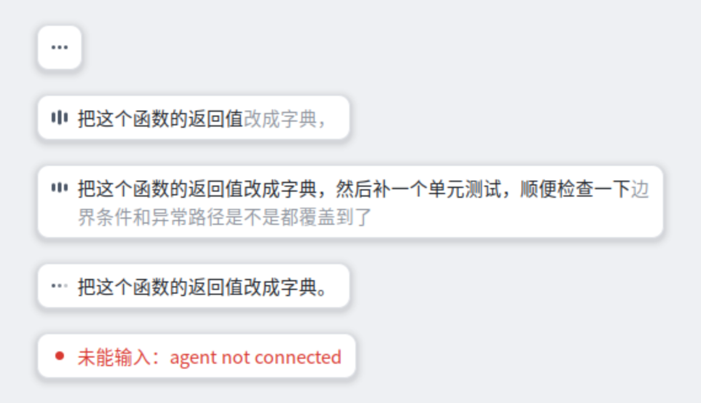

# 架构

## 角色

```text
X99 Voice Server
  ├─ 音频采集 / PTT / ASR / 术语修正 / 结果缓存
  ├─ active_target 状态机
  └─ TCP/JSON 文本分发

每台目标主机 Voice Agent
  ├─ 连接 Voice Server，接收 insert_text
  ├─ 本机 127.0.0.1:8766 接收 Deskflow enter/leave
  ├─ 活跃时发送 heartbeat
  ├─ 本机文本注入（Windows SendInput / Linux XTest）
  └─ 光标跟随 HUD（partial / final）
```

Voice Server 与 Deskflow Server 不必是同一台；当前都在 X99。

## 语音链路

```text
PTT evdev 按键按住/松开
  → sounddevice 采集（USB 麦克风，48k 单声道）
  → 线性重采样到 16k + 峰值归一化
  → 按下即锁定目标主机并弹出聆听浮窗；partial 预览更新（见下）→ 目标机 HUD
  → 松开: 整段解码（或流式 refresh 收尾）
  → zhconv 繁转简
  → voice-tunnel send（target=active）→ Agent 注入
```

默认不自动按 Enter。partial 只做预览，不写入编辑器；最终文本在松开后插入。

三种识别模式：

| 模式 | partial 做法 | 松手后 | 延迟 |
| --- | --- | --- | --- |
| faster-whisper | 每 0.5s 用 small 重解码全段，取连续两次的最长公共前缀 | 整段解码 | ~0.2s |
| Qwen3-ASR（transformers） | 每 0.8s 重解码最近 8s | 整段解码 | ~1s |
| Qwen3-ASR（vLLM 流式） | 每 0.12s 推送新音频，服务端合并后解一次（前缀回滚 5 token） | 无前缀整段 refresh | 首字 0.5s，刷新约 0.24s，松手 0.27s |

流式（vLLM）调度（`scripts/qwen_asr_service.py`，不使用库自带的固定块长循环）：

1. 监听端每 0.12s 把新录到的音频全部推给 `/stream/chunk`；最近 0.8s 内有语音才要求解码，静音段只追加；
2. 服务端把新音频并入后只解一次（新音频 ≥0.1s 才解）：前 1.5s 不用前缀，之后以上次结果回滚 5 个 token 为前缀，尾部可被修正；解码慢时请求自然合并，延迟不累积；
3. 停顿 0.7s 调 `/stream/refresh` 做无前缀整段重解码，修正前文；当前段已超过 20s 时把结果定稿，之后只解码新的一段（长句不受生成长度限制，解码耗时不随句长增长）；松手同样用 refresh 收尾；
4. 服务启动时先做一次预热解码，避免第一次按键等 4s 以上的编译。

服务端接口：`/stream/start`、`/stream/chunk`（`decode` 控制是否解码）、`/stream/refresh`、`/stream/cancel`。

## 文本分发

- 传输：TCP + 换行 JSON，token 认证。
- `request_id` 由服务端生成，Agent 去重，重试不会重复插入。
- 默认只插入文本，不自动按 Enter。

## active_target 状态机

Deskflow 的 `enterCommand` / `exitCommand` 在**被进入/离开的机器**上执行（Flatpak 沙箱内可直接 `curl`）。事件链：

```text
Deskflow 切屏
  → 目标机 enterCommand
  → curl 'http://127.0.0.1:8766/active?state=enter'
  → 本机 Agent 标记 active，并每 5s 向 Voice Server 发 heartbeat
  → 服务端更新 active_target
```

规则：

- `enter` 设置 `active_target`，并向其他自认为活跃的 Agent 发 `active_state=false`（同一时刻只有一个鼠标；用于修复丢失的 leave）。
- `leave` 只在 `active_target == 自己` 时生效，且有 1.5s 宽限（Windows Deskflow 常出现 leave→enter 抖动）。
- 宽限过后仍无新 enter：鼠标在没有 Agent 的屏幕上，目标为“无”，不回退默认主机。
- `default_target` 只在服务端启动后、尚未收到任何切屏事件时使用。
- 所有 Agent 每 3s 心跳（携带 active），服务端回 pong；15s 无消息即断开连接，Agent 读超时 15s 自动重连。活跃心跳可在目标为空时恢复丢失的 enter。
- 一句话的目标在按下说话键时锁定，浮窗和最终插入都发往同一台机器。
- 支持手动覆盖；超时后失效。

## HUD



从上到下：静音聆听、识别中（浅灰为尚未稳定的尾字）、长句换行、松手后整段校正、上屏失败提示。

- 事件（服务端 `hud` 消息）：`listen`（按下即弹出）、`level`（音量）、`partial`（文本 + 已稳定字数）、`finish`（松手，整段校正中）、`commit`（上屏，立即消失）、`error`（2.5s 后消失）、`hide`。
- 状态机 `HudModel` 与绘制分离：新字逐字显现（约 0.1s 追上），被改写的部分立即替换；已稳定文字深色、尾部浅灰；左侧 3 根音量条（静音时为三点），收尾时三点呼吸，错误为红点；无事件 8s 自动收起。
- 外观：白色卡片、9px 圆角、1px 浅描边、轻投影；宽度随内容增长且一句话内只增不减（上限 520px），最多 3 行，超出只保留末尾并以省略号开头。
- 定位：Ubuntu 跟随鼠标（按下说话键时的鼠标位置右下方，一句话内不动）；Windows 放在输入光标正下方、文字起点对齐光标，下方放不下放上方；均限制在所在显示器工作区内。
- Windows 光标来源：先 `GetGUIThreadInfo.rcCaret`，再 MSAA `OBJID_CARET`，都拿不到时用聚焦窗口内的鼠标或窗口左下角。Ubuntu 曾尝试 fcitx 光标上报与 AT-SPI：终端等 GTK 程序只在聚焦/按键时上报，微信/Edge/VS Code 默认不开放 AT-SPI，说话时常拿不到光标，2026-11-12 改为统一跟随鼠标。
- Linux 渲染：GTK3 override-redirect 弹层（不经窗口管理器，永不抢焦点）+ cairo。Windows 渲染：Tk 画布，`WS_EX_NOACTIVATE|TOOLWINDOW|TOPMOST`、`CS_DROPSHADOW`，`SW_SHOWNOACTIVATE` 显示，进程 Per-Monitor DPI 感知。
- Agent 必须带图形会话环境运行：Linux 远端用 `~/voice-tunnel/run-agent.sh`（DISPLAY/XAUTHORITY/XDG_RUNTIME_DIR/DBUS）；Windows 用计划任务 VoiceTunnelAgent（`start-agent.cmd` → `restart.ps1`，该脚本须保存为 UTF-8 BOM）。

## 文本注入

| 平台 | 首选 | 回退 |
|---|---|---|
| Windows | `SendInput` + `KEYEVENTF_UNICODE`，整段一次提交 | 无（剪贴板不作为默认） |
| Linux X11 | `inject_mode=clipboard`：xclip + `xprop WM_CLASS` 判断窗口 → 终端 `Ctrl+Shift+V`，其他 `Ctrl+V`；0.8s 后后台还原剪贴板 | `xdotool type`（仅无 IME 的 US 布局，兼容性差） |

剪贴板会短暂覆盖系统剪贴板；当前只备份/还原文本，图片/HTML 多格式内容不做无损恢复承诺。Linux 部署默认启用 `inject_mode=clipboard`。

## 安全

- 只监听局域网，防火墙限制端口。
- token 认证；不做远程命令执行，只接受 `insert_text`。
- 文本长度上限；Agent 只绑定 `127.0.0.1:8766` 接收 Deskflow 事件。
